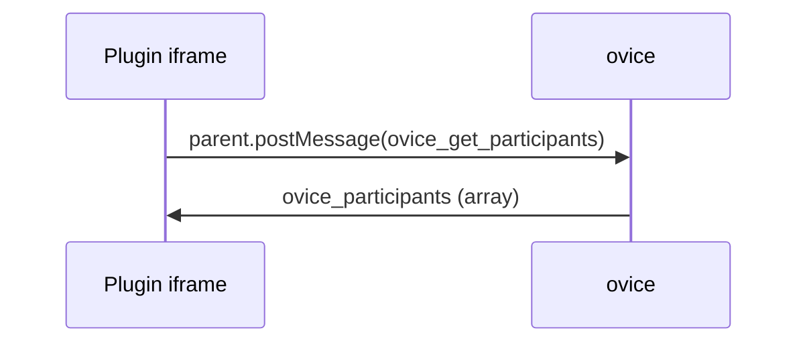
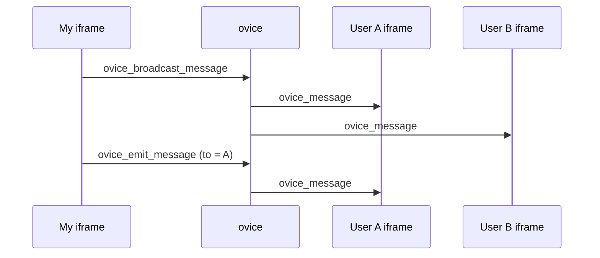
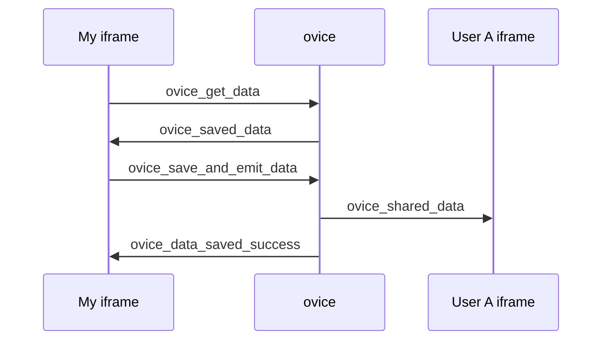

# ovice Custom Plugin events — full reference

Source of truth: `docs/technical_details_for_developers.md` in
[oviceinc/custom-plugins](https://github.com/oviceinc/custom-plugins). This file mirrors it
in a compact form and adds notes learned from the example plugins.

All messages have the shape `{ type: string, payload?: unknown }`.

## Participant object

Used by `ovice_participants` (array) and every `ovice_participant_*` event (single).

| Field | Type | Notes |
| --- | --- | --- |
| `id` | string \| number | User id. Normalise to string. |
| `name` | string | Display name. |
| `avatarUrl` | string | Avatar image URL. |
| `objectId` | string | Object the plugin is attached to. |
| `objectType` | `"static"` \| `"dynamic"` | Dynamic objects are owned by a user. |
| `workspaceId` | string \| number | Normalise to string. |
| `isSelf` | boolean | `true` for the user running this iframe. |
| `isHost` | boolean? | Owner of a dynamic object. Never true on static objects. |
| `isVisitor` | boolean | Visitor / guest account. |
| `status` | `"subscribed"` \| `"joined"` \| `"left"` \| `"unsubscribed"` | Present in `ovice_participants`. |
| `language` | string? | Preferred language, e.g. `"en"`, `"ja"`. |
| `email` | string? | Only on `ovice_participant_*` events, and only if the org owner allowed it in the custom plugin settings. |

TypeScript:

```ts
export type OviceParticipant = {
  id: string | number;
  name: string;
  avatarUrl: string;
  objectId: string;
  objectType: 'static' | 'dynamic';
  workspaceId: string | number;
  isSelf?: boolean;
  isHost?: boolean;
  isVisitor: boolean;
  status?: 'subscribed' | 'joined' | 'left' | 'unsubscribed';
  language?: string;
  email?: string;
};
```

## 1. Initial connection / participant list



```json
{ "type": "ovice_get_participants" }
```

```json
{
  "type": "ovice_participants",
  "payload": [
    { "id": "123456", "name": "John Doe", "objectId": "obj1", "objectType": "static",
      "avatarUrl": "https://example.com/a.jpg", "workspaceId": 987,
      "isHost": false, "isSelf": true, "isVisitor": false, "status": "joined", "language": "en" }
  ]
}
```

Notes:
- Send it on mount **and** after every `ovice_participant_*` event (debounced ~1 s).
- The reference client drops entries without `id` or `workspaceId`.

## 2. Participant status events (ovice → plugin)

`ovice_participant_subscribed`, `ovice_participant_unsubscribed`,
`ovice_participant_joined`, `ovice_participant_left` — `payload` is one participant object.

```json
{
  "type": "ovice_participant_joined",
  "payload": { "id": "123456", "name": "John Doe", "objectId": "obj1", "objectType": "dynamic",
    "avatarUrl": "https://example.com/a.jpg", "workspaceId": 987,
    "isHost": true, "isSelf": true, "isVisitor": false, "language": "en",
    "email": "john@example.com" }
}
```

Notes:
- The spec describes these as events for "the user who initiated the iframe", but the
  examples (meeting-cash-clock, useCacheStore) also react to other users' events — always
  check `payload.isSelf`.

## 3. Real-time messages

### `ovice_broadcast_message` (plugin → ovice)

Send to every user subscribed/joined to the same object.

```json
{
  "type": "ovice_broadcast_message",
  "payload": { "event": "quiz:start", "message": { "question": 3 } }
}
```

The spec also lists `source` (sender user id) and `objectId` in the payload. The example
clients send only `event` + `message` and still read `source` on the receiving side
(`useCacheStore` replies to `event.source`), i.e. they rely on ovice filling it in. If you
need the sender reliably, also put the sender id inside `message`. `message` can be any
JSON value, max **2 MB**.

### `ovice_emit_message` (plugin → ovice)

Send to one user. Same as broadcast plus `to` (target user id, **string**).

```json
{
  "type": "ovice_emit_message",
  "payload": { "event": "quiz:state", "message": { "round": 2 }, "to": "123" }
}
```

### `ovice_message` (ovice → plugin)

How broadcast/emit messages arrive at the recipients.

```json
{
  "type": "ovice_message",
  "payload": { "source": "12", "event": "quiz:start", "objectId": "obj1",
    "message": { "question": 3 }, "to": "123" }
}
```

`to` is present only for emitted (direct) messages.



## 4. Object data store *(under development)*

Persisted per object. Payload must be a JSON object, max **500 KB**.



| `type` | Direction | Payload |
| --- | --- | --- |
| `ovice_get_data` | plugin → ovice | none |
| `ovice_saved_data` | ovice → plugin | stored object |
| `ovice_save_and_emit_data` | plugin → ovice | object to store (replaces the whole value) |
| `ovice_shared_data` | ovice → other plugins | the newly stored object |
| `ovice_data_saved_success` | ovice → saving plugin | stored object + `updated_at` (unix seconds) |

```json
{ "type": "ovice_save_and_emit_data", "payload": { "value1": "12", "value2": "test" } }
```

```json
{ "type": "ovice_data_saved_success", "payload": { "updated_at": 1703214224, "value1": "12", "value2": "test" } }
```

## 5. Undocumented handshake

`tools/test` (the mock host) sends `{ type: 'ovice_confirmation' }` in response to
`ovice_ready`, and the reference client answers `ovice_confirmation` with
`{ type: 'ovice_ready_confirmed' }`. Not in the public spec — keep the reply in custom
clients for compatibility, but don't depend on it.
