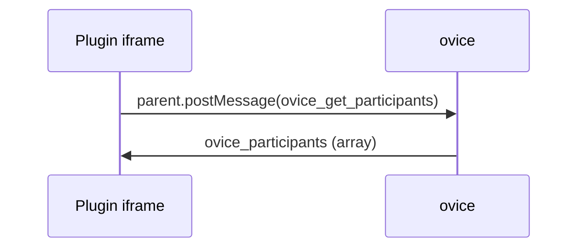
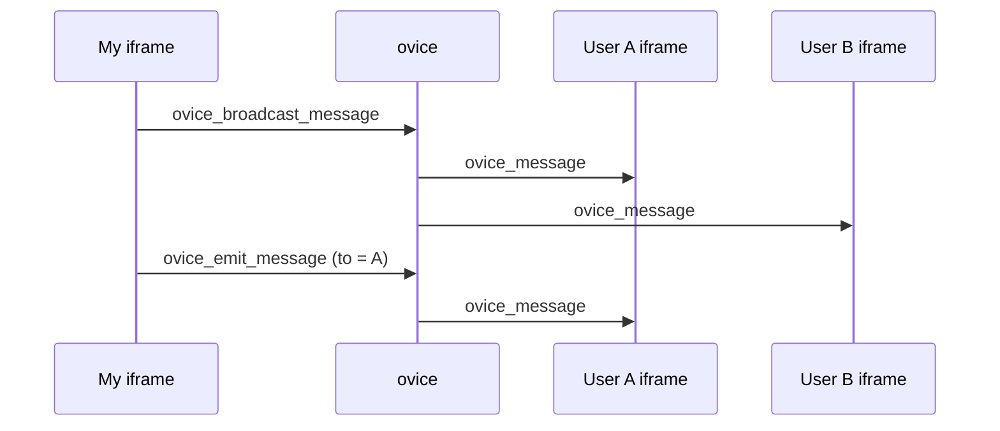
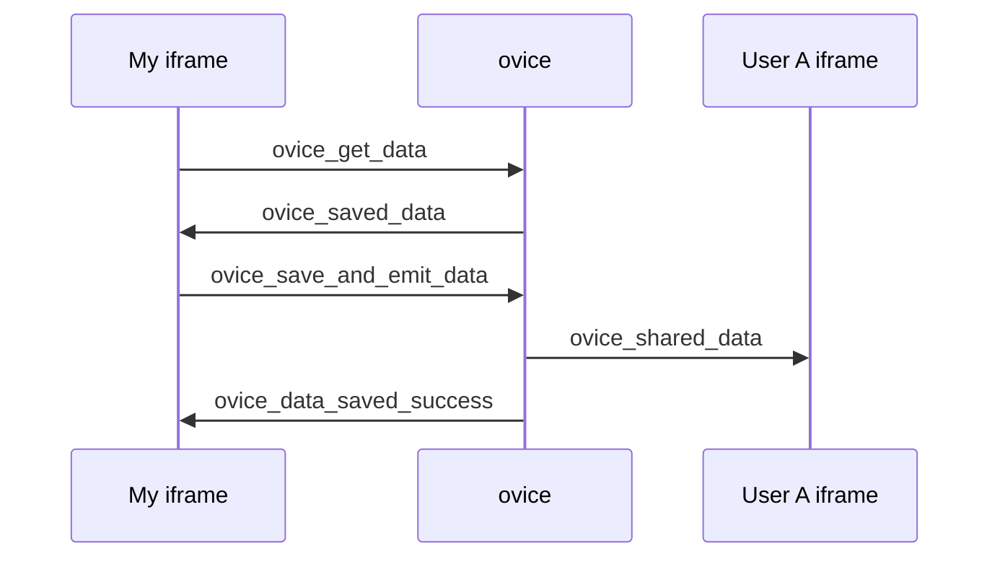

# ovice Custom Plugin events — full reference

Sources: the public spec `docs/technical_details_for_developers.md` in
[oviceinc/custom-plugins](https://github.com/oviceinc/custom-plugins), checked against the
real host implementation in ovice-ui (`routes/workspace/SpaceObject/plugins/custom_plugin.tsx`,
`CustomPlugin/schema.ts`). Where they disagree, this file follows the host and says so.

All legacy messages have the shape `{ type: string, payload?: unknown }`. ovice also posts
every event a second time as a JSON-RPC 2.0 notification
(`{ jsonrpc: '2.0', method: <type>, params: <payload> }`); dispatch on `data.type` and
ignore messages without one.

## Participant object

Used by `ovice_participants` (array) and every `ovice_participant_*` event (single).

| Field | Type | Notes |
| --- | --- | --- |
| `id` | string | User id (a numeric string). Still compare with `String()`. |
| `name` | string | Display name. |
| `avatarUrl` | string | Avatar image URL. |
| `objectId` | string | Object the plugin is attached to. |
| `objectType` | `"static"` \| `"dynamic"` | Dynamic objects are owned by a user. |
| `workspaceId` | string | |
| `isSelf` | boolean | `true` for the user running this iframe. |
| `isHost` | boolean | Owner of a dynamic object. Never true on static objects. |
| `isVisitor` | boolean | Visitor / guest account. |
| `status` | `"joined"` \| `"subscribed"` | **Only in `ovice_participants`.** Not present in events. |
| `languge` | string? | **Only in events**, and spelled `languge` (sic). |
| `email` | string? | Only your own, and only if the org owner allowed it in the custom plugin settings. |

TypeScript:

```ts
export type OviceParticipant = {
  id: string;
  name: string;
  avatarUrl: string;
  objectId: string;
  objectType: 'static' | 'dynamic';
  workspaceId: string;
  isSelf: boolean;
  isHost: boolean;
  isVisitor: boolean;
  status?: 'joined' | 'subscribed'; // ovice_participants only
  languge?: string;                 // events only (sic)
  email?: string;
};
```

## 1. Participant list



```json
{ "type": "ovice_get_participants" }
```

```json
{
  "type": "ovice_participants",
  "payload": [
    { "id": "123456", "objectId": "obj1", "name": "John Doe",
      "avatarUrl": "https://example.com/a.jpg", "workspaceId": "987",
      "isHost": false, "status": "joined", "isSelf": true, "isVisitor": false,
      "objectType": "static" }
  ]
}
```

Notes:
- This is the only reliable way to learn who you are. Send it on mount, ~1 s after every
  `ovice_participant_*` event, and periodically (newcomers produce no event, see below).
- Lists everyone in range of the object (`subscribed`) or linked to it (`joined`).
  A user who unlinked but is still in range is listed as `subscribed`.

## 2. Participant status events (ovice → plugin)

`ovice_participant_subscribed`, `ovice_participant_unsubscribed`,
`ovice_participant_joined`, `ovice_participant_left` — `payload` is one participant object
(without `status`).

```json
{
  "type": "ovice_participant_joined",
  "payload": { "id": "123456", "name": "John Doe", "avatarUrl": "https://example.com/a.jpg",
    "objectId": "obj1", "workspaceId": "987", "isHost": true, "objectType": "dynamic",
    "isSelf": true, "isVisitor": false, "languge": "en" }
}
```

How they are produced:
- Each client generates events only for **its own** user, posts them to its own iframe
  (`isSelf: true`), and relays them to everyone else on the object, where they arrive
  with `isSelf: false` (and without `email`).
- The plugin iframe is created when the user comes into range. The user's initial
  `subscribed` event (and `joined`, if they are already linked) fires before the
  iframe is ready and is **lost**, both for that user and for the others. Later
  `joined` / `left` / `unsubscribed` transitions are delivered.
- `unsubscribed` is sent just before the iframe is removed.

## 3. Real-time messages

### `ovice_broadcast_message` (plugin → ovice)

Send to every **other** user on the object (the sender never receives a copy).

```json
{
  "type": "ovice_broadcast_message",
  "payload": { "event": "quiz:start", "message": { "from": "123456", "question": 3 } }
}
```

The payload is validated with a strict schema. Any other key makes ovice drop the request
and post `ovice_errors`:

| Key | Rule |
| --- | --- |
| `event` | string, 3–256 chars |
| `message` | number \| string \| boolean \| object \| array of (string \| number \| boolean \| object). Required. `null`, `undefined` and nested arrays are rejected. Max 2 MB. |

> The public spec shows `source` and `objectId` inside this payload. **Don't send them**:
> the real host rejects the request.

### `ovice_emit_message` (plugin → ovice)

Send to one user. Same rules plus `to`: the target user id as a **string** (1–256 chars).
Emitting to yourself is ignored. The message reaches every custom plugin iframe the target
has open, so namespace `event`.

```json
{
  "type": "ovice_emit_message",
  "payload": { "event": "quiz:state", "message": { "from": "123456", "round": 2 }, "to": "123" }
}
```

### `ovice_message` (ovice → plugin)

How broadcast/emit messages arrive. `payload` is **exactly what the sender posted**:

```json
{ "type": "ovice_message", "payload": { "event": "quiz:start", "message": { "from": "123456", "question": 3 } } }
```

```json
{ "type": "ovice_message", "payload": { "event": "quiz:state", "message": { "from": "123456", "round": 2 }, "to": "123" } }
```

There is **no `source` and no `objectId`** (the spec says otherwise). Put the sender id in
`message` yourself when receivers need it.



### Rate limit

At most **100** `ovice_broadcast_message` + `ovice_emit_message` + `ovice_save_and_emit_data`
requests per minute per iframe. The rest are dropped with
`ovice_errors: "You're sending too many messages."`.

## 4. Object data store *(not available in production)*

**Production ovice ignores the legacy `{ type: 'ovice_get_data' }` and
`{ type: 'ovice_save_and_emit_data' }` messages** (they are "under development" and only
handled in development builds). The JSON-RPC methods of the same name (section 6) are not
blocked in the current host source, but the feature is still marked under development:
don't use the data store for sync or as the only copy of state.

In development builds:



| `type` | Direction | Payload |
| --- | --- | --- |
| `ovice_get_data` | plugin → ovice | none |
| `ovice_saved_data` | ovice → plugin | stored object (`{}` on dynamic objects) |
| `ovice_save_and_emit_data` | plugin → ovice | plain object to store, max **50 KB**, replaces the whole value |
| `ovice_shared_data` | ovice → other plugins | the new object |
| `ovice_data_saved_success` | ovice → saving plugin | the stored object, after the API save (static objects only, throttled ~1 s) |

Dynamic objects are not persisted: others still get `ovice_shared_data`, but there is no
`ovice_data_saved_success` and `ovice_get_data` returns `{}`.

## 5. Errors

```json
{ "type": "ovice_errors", "payload": ["/event too_small ..."] }
```

Sent when a request fails validation, exceeds a size limit or hits the rate limit.
`payload` is a string or an array of strings. Log it while developing.

## 6. Other requests

- `ovice_change_user_state` — `{ action: 'in_range' | 'out_of_range', status: 'available' | 'busy' }`:
  sets the user's availability when they are in range / leave the object.
- `ovice_ready`, `ovice_ready_confirmed` and any other type are ignored. ovice never sends
  `ovice_confirmation`. The reference client still answers it, which is harmless.
- JSON-RPC 2.0 requests (`{ jsonrpc: '2.0', id, method, params }`, same method names) are
  also accepted and answered with `{ jsonrpc, id, result | error }`. `params` follow the
  same strict schemas as the legacy payloads, and the same rate limit applies. Errors come
  back as JSON-RPC errors (`-32602` invalid params, `-32000` too many messages / payload too
  large) instead of `ovice_errors`.
