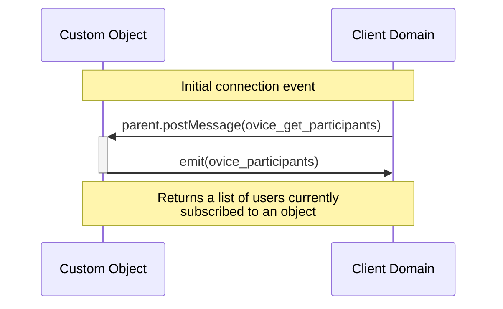
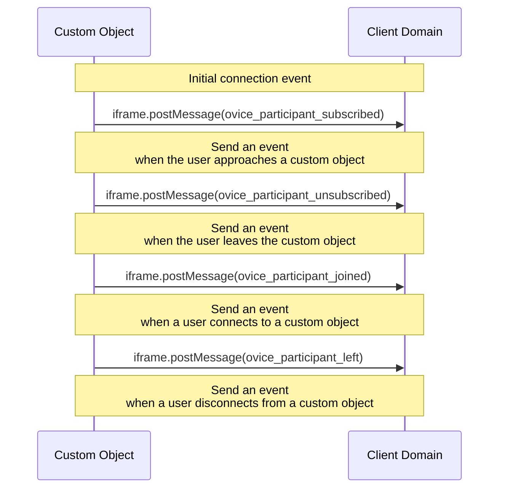
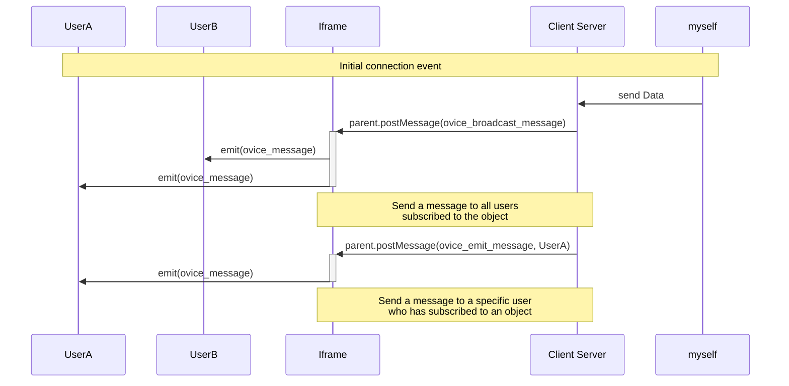
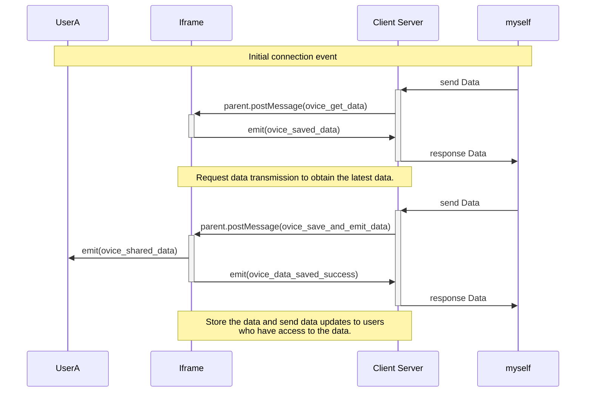

# Technical Details for Developers: Custom Plugins Integration

## Table of Contents

- [Overview](#overview)
- [Communication Mechanism](#communication-mechanism)
- [Event Handling](#event-handling)
  - [Connection Initialization Events](#connection-initialization-events)
  - [Participant Related Events](#participant-related-events)
  - [Other Participant Related Events](#other-participant-related-events)
  - [Participant Information Retrieval Events](#participant-information-retrieval-events)
  - [Real-time Communication Events](#real-time-communication-events)
  - [Reflected Event](#reflected-event)
  - [Data Management Events](#data-management-events-under-development)
  - [Error Event](#error-event)
  - [Other Requests](#other-requests)
- [Limits and Behaviour Notes](#limits-and-behaviour-notes)
- [Additional Information for Status:](#additional-information-for-status)

## Overview

This document outlines the technical specifications for developers integrating custom plugins with our platform. The integration is based on real-time communication between domains through iframe postMessage, enabling developers to create a seamless user experience.

## Communication Mechanism

The communication mechanism is designed for interaction between two domains via iframe. It includes:

- Exchange of events for participant management
- Information retrieval on participants
- Custom communication between users within their respective domains

## Event Handling

Explanation and specification of events are categorized based on their context.

### Participant Information Retrieval Events

Events to retrieve information about participants linked or subscribed to an object.
Note : We recommend using this event for initial communication.

#### Events Overview



#### `ovice_get_participants`

- **Description:** Triggered when the client's domain requests a list of participants, including the self-user, who have joined or subscribed to the object.

  ```json
  { "type": "ovice_get_participants" }
  ```

#### `ovice_participants`

- **Description:** Triggered when client requests a list of participants by sending `ovice_get_participants` event
- **Data Format: Array of Participants**

  - **id** (string): Unique identifier of the user.
  - **objectId** (string): Unique identifier of the object that the user is associated with.
  - **objectType** (string): Represents the type of the object (static or dynamic).
  - **name** (string): Name of the user.
  - **avatarUrl** (string): Avatar icon of the user.
  - **workspaceId** (string): Workspace ID of the user.
  - **email** (string, conditional): Only on the self entry, and only when the owner of the organization grants permission from the custom plugin setting page.
  - **status** (string): `"joined"` (linked to the object) or `"subscribed"` (within range, not linked). A user who left but is still in range is listed as `"subscribed"`.
  - **isHost** (boolean): Indicates whether the user is the owner of the dynamic object.
  - **isSelf** (boolean): represents if the user is self.
  - **isVisitor** (boolean): represents if the user is visitor or guest.

  ```json
  {
    "type": "ovice_participants",
    "payload": [
      {
        "id": "123456",
        "name": "John Doe",
        "objectId": "participantObjectId",
        "objectType": "static",
        "avatarUrl": "<https://example.com/avatar.jpg>",
        "workspaceId": "987",
        "isHost": false,
        "isSelf": true,
        "isVisitor": false,
        "status": "joined"
      },
      {
        "id": "234567",
        "name": "Jane Roe",
        "objectId": "participantObjectId",
        "objectType": "static",
        "avatarUrl": "<https://example.com/avatar.jpg>",
        "workspaceId": "987",
        "isHost": false,
        "isSelf": false,
        "isVisitor": true,
        "status": "subscribed"
      }
    ]
  }
  ```

### Participant Related Events

These events manage the current user's interaction with custom objects.

- Each client produces these events for **its own user only**. The event is posted to that user's iframe with `isSelf: true` and relayed to the other users on the object, who receive the same payload with `isSelf: false` (and without `email`).
- The payload has **no `status`** field. Derive the status from the event type.
- The plugin iframe is created when the user comes within range of the object. The user's initial `ovice_participant_subscribed` (and `ovice_participant_joined`, if the user is already linked) is fired before the iframe is ready, so **neither the user nor the others receive it**. Later `joined`, `left` and `unsubscribed` transitions are delivered.
- Therefore use `ovice_get_participants` on start-up to learn who you are, and request it again after participant events and periodically to notice newcomers.

#### Events Overview



#### `ovice_participant_subscribed`

- **Description:** Triggered when the user who initiated the iframe subscribes to the object.
- **Data Format:**

  - **email** (string, conditional): Email address of the user. Provided only when the owner of the organization grants permission from the custom plugin setting page.
  - **id** (string): Unique identifier of the user.
  - **objectId** (string): Unique identifier of the object that the user is associated with.
  - **objectType** (string): Represents the type of the object (static or dynamic).
  - **name** (string): Name of the user.
  - **avatarUrl** (string): Avatar icon of the user.
  - **workspaceId** (string): Workspace ID of the user.
  - **languge** (string, optional): Preferred language of the user. Note the spelling: the key is sent as `languge`.
  - **isHost** (boolean): Indicates whether the user is the owner of the dynamic object.
  - **isSelf** (boolean): represents if the user is self.
  - **isVisitor** (boolean): represents if the user is visitor or guest.

  ```json
  {
    "type": "ovice_participant_subscribed",
    "payload": {
      "id": "123456",
      "email": "[example@example.com](<mailto:example@example.com>)",
      "name": "John Doe",
      "objectId": "participantObjectId",
      "objectType": "dynamic",
      "avatarUrl": "https://example.com/avatar.jpg",
      "workspaceId": "987",
      "isHost": false,
      "isSelf": true,
      "isVisitor": true,
      "languge": "en"
    }
  }
  ```

#### `ovice_participant_unsubscribed`

- **Description:** Triggered when the user who initiated the iframe unsubscribes from the object.
- **Data Format:**

  - **email** (string, conditional): Email address of the user. Provided only when the owner of the organization grants permission from the custom plugin setting page.
  - **id** (string): Unique identifier of the user.
  - **objectId** (string): Unique identifier of the object that the user is associated with.
  - **objectType** (string): Represents the type of the object (static or dynamic).
  - **name** (string): Name of the user.
  - **avatarUrl** (string): Avatar icon of the user.
  - **workspaceId** (string): Workspace ID of the user.
  - **languge** (string, optional): Preferred language of the user. Note the spelling: the key is sent as `languge`.
  - **isHost** (boolean): Indicates whether the user is the owner of the dynamic object.
  - **isSelf** (boolean): represents if the user is self.
  - **isVisitor** (boolean): represents if the user is visitor or guest.

  ```json
  {
    "type": "ovice_participant_unsubscribed",
    "payload": {
      "id": "123456",
      "email": "[example@example.com](<mailto:example@example.com>)",
      "name": "John Doe",
      "objectId": "participantObjectId",
      "objectType": "dynamic",
      "avatarUrl": "https://example.com/avatar.jpg",
      "workspaceId": "987",
      "isHost": false,
      "isSelf": true,
      "isVisitor": true,
      "languge": "en"
    }
  }
  ```

#### `ovice_participant_joined`

- **Description:** Triggered when the user who initiated the iframe links to the object.
- **Data Format:**

  - **email** (string, conditional): Email address of the user. Provided only when the owner of the organization grants permission from the custom plugin setting page.
  - **id** (string): Unique identifier of the user.
  - **objectId** (string): Unique identifier of the object that the user is associated with.
  - **objectType** (string): Represents the type of the object (static or dynamic).
  - **name** (string): Name of the user.
  - **avatarUrl** (string): Avatar icon of the user.
  - **workspaceId** (string): Workspace ID of the user.
  - **languge** (string, optional): Preferred language of the user. Note the spelling: the key is sent as `languge`.
  - **isHost** (boolean): Indicates whether the user is the owner of the dynamic object.
  - **isSelf** (boolean): represents if the user is self.
  - **isVisitor** (boolean): represents if the user is visitor or guest.

  ```json
  {
    "type": "ovice_participant_joined",
    "payload": {
      "id": "123456",
      "email": "[example@example.com](<mailto:example@example.com>)",
      "name": "John Doe",
      "objectId": "participantObjectId",
      "objectType": "static",
      "avatarUrl": "<https://example.com/avatar.jpg>",
      "workspaceId": "987",
      "isHost": true,
      "isSelf": true,
      "isVisitor": true,
      "languge": "en"
    }
  }
  ```

#### `ovice_participant_left`

- **Description:** Triggered when the user who initiated the iframe unlinks from the object.
- **Data Format:**

  - **email** (string, conditional): Email address of the user. Provided only when the owner of the organization grants permission from the custom plugin setting page.
  - **id** (string): Unique identifier of the user.
  - **objectId** (string): Unique identifier of the object that the user is associated with.
  - **objectType** (string): Represents the type of the object (static or dynamic).
  - **name** (string): Name of the user.
  - **avatarUrl** (string): Avatar icon of the user.
  - **workspaceId** (string): Workspace ID of the user.
  - **languge** (string, optional): Preferred language of the user. Note the spelling: the key is sent as `languge`.
  - **isHost** (boolean): Indicates whether the user is the owner of the dynamic object.
  - **isSelf** (boolean): represents if the user is self.
  - **isVisitor** (boolean): represents if the user is visitor or guest.

  ```json
  {
    "type": "ovice_participant_left",
    "payload": {
      "id": "123456",
      "email": "[example@example.com](<mailto:example@example.com>)",
      "name": "John Doe",
      "objectId": "participantObjectId",
      "objectType": "static",
      "avatarUrl": "<https://example.com/avatar.jpg>",
      "workspaceId": "987",
      "isHost": false,
      "isSelf": true,
      "isVisitor": true,
      "languge": "en"
    }
  }
  ```

### Real-time Communication Events

Facilitate custom interactions among users who are linked or subscribed to the same object.

The payload of both requests is validated strictly. A request that does not match is **dropped** and an [`ovice_errors`](#error-event) event is sent back to the iframe:

- Only the keys listed below are allowed. Any other key (for example `source` or `objectId`) makes the whole request invalid.
- **event**: string, 3–256 characters.
- **message**: required. A number, string, boolean, object, or an array whose items are strings, numbers, booleans or objects. `null`, `undefined` and nested arrays are rejected.
- **to** (emit only): string, 1–256 characters.

The receivers do not learn who sent a message (see [`ovice_message`](#ovice_message)). If they need to know, include the sender's user id inside `message`.

#### `ovice_broadcast_message`

- **Description:** Allows the client to send their own event to the other users that are subscribed to or joined to the same object. The sender does not receive its own message.
- **Payload:**
  - **event** (string): The type of event being sent.
  - **message** (unknown): The payload of the event, which can be a string, number, boolean, object or array.
    - **Note:** The payload size for **`message`** is limited to 2MB.
- **Additional Behavior:**

  - When the targeted users receive this event, it will be reflected back to their client domain as an `ovice_message` whose payload is the payload sent here.

  ```json
  {
    "type": "ovice_broadcast_message",
    "payload": {
      "event": "exampleEvent",
      "message": {
        "from": "12",
        "key1": "value1",
        "key2": 42,
        "key3": ["item1", "item2"]
      }
    }
  }
  ```

#### `ovice_emit_message`

- **Description:** Allows the client to send their own event to a specific user who has joined or subscribed to the object. Emitting to yourself is ignored.
- **Payload:**
  - **event** (string): The type of event being sent.
  - **message** (unknown): The payload of the event, which can be a string, number, boolean, object or array.
    - **Note:** The payload size for **`message`** is limited to 2MB.
  - **to** (string): The identifier of the specific user to whom the event is targeted. Must be a string.
- **Additional Behavior:**

  - When the targeted user receives this event, it will be reflected back to their client domain as an `ovice_message` whose payload is the payload sent here (including `to`).
  - The message is delivered to every custom plugin iframe the target user has open, so use event names specific to your plugin.

  ```json
  {
    "type": "ovice_emit_message",
    "payload": {
      "event": "exampleEvent",
      "message": {
        "from": "12",
        "key1": "value1",
        "key2": 42,
        "key3": ["item1", "item2"]
      },
      "to": "123"
    }
  }
  ```

### Reflected Event

#### Events Overview



#### `ovice_message`

- **Description:** Reflects events sent from the client to targeted users back to the client domain.
- **Payload:** exactly the payload of the original `ovice_broadcast_message` / `ovice_emit_message`. ovice does **not** add the sender (`source`) or the object id (`objectId`).

  - **event** (string): The type of reflected event.
  - **message** (unknown): The original message.
  - **to** (string, emit only): The identifier of the user to whom the event was targeted.

  ```json
  {
    "type": "ovice_message",
    "payload": {
      "event": "exampleEvent",
      "message": {
        "from": "12",
        "key1": "value1",
        "key2": 42,
        "key3": ["item1", "item2"]
      }
    }
  }
  ```

### Data Management Events (under development)

> **Not available in production.** Production ovice ignores the `ovice_get_data` and `ovice_save_and_emit_data` requests. Do not use the data store to synchronise users or as the only copy of your state.
>
> In development builds the data is persisted for static objects only. Dynamic objects are not persisted: the other users still receive `ovice_shared_data`, but `ovice_get_data` returns `{}` and no `ovice_data_saved_success` is sent.

#### Events Overview



#### `ovice_get_data`

- **Description:** Triggered when a client's domain requests the latest data associated with an object.

  ```json
  { "type": "ovice_get_data" }
  ```

#### `ovice_saved_data`

- **Description:** Signifies that the requested data has been successfully retrieved and saved, confirming the completion of the data retrieval process.

- **Payload:**

  - **payload** (object): Data stored in the object
    - **Note:** The payload size for **`payload`** is limited to 50KB.

  ```json
  {
    "type": "ovice_saved_data",
    "payload": {
      "value1": "12",
      "value2": "test"
    }
  }
  ```

#### `ovice_save_and_emit_data`

- **Description:** Instructs the system to save the provided data and simultaneously emit an update to all relevant users who are subscribed to or monitoring the data.

- **Payload:**

  - **payload** (object): Data stored in the object
    - **Note:** The payload size for **`payload`** is limited to 50KB.

  ```json
  {
    "type": "ovice_save_and_emit_data",
    "payload": {
      "value1": "12",
      "value2": "test"
    }
  }
  ```

#### `ovice_shared_data`

- **Description:** Indicates that the data has been shared or made available to specific users who are part of the data-sharing process or have subscribed to receive updates.

- **Payload:**

  - **payload** (object): Data stored in the object
    - **Note:** The payload size for **`payload`** is limited to 50KB.

  ```json
  {
    "type": "ovice_shared_data",
    "payload": {
      "value1": "12",
      "value2": "test"
    }
  }
  ```

#### `ovice_data_saved_success`

- **Description:** Confirms that the data has been successfully saved in the system, ensuring that the data storage process is complete and reliable. Sent to the saving user after the data is stored (saves are throttled to about one per second).

- **Payload:**

  - **payload** (object): Data stored in the object
    - **Note:** The payload size for **`payload`** is limited to 50KB.

  ```json
  {
    "type": "ovice_data_saved_success",
    "payload": {
      "value1": "12",
      "value2": "test"
    }
  }
  ```

### Error Event

#### `ovice_errors`

- **Description:** Sent to the iframe when one of its requests is rejected: invalid payload, payload too large, or too many messages.
- **Payload:** a string or an array of strings describing the problem.

  ```json
  {
    "type": "ovice_errors",
    "payload": [" unrecognized_keys Unrecognized key(s) in object: 'source', 'objectId'"]
  }
  ```

### Other Requests

#### `ovice_change_user_state`

- **Description:** Changes the user's availability while they are within range of the object (`in_range`) or when they leave it (`out_of_range`).

  ```json
  {
    "type": "ovice_change_user_state",
    "payload": { "action": "in_range", "status": "busy" }
  }
  ```

  - **action**: `"in_range"` or `"out_of_range"`.
  - **status**: `"available"` or `"busy"`.

#### JSON-RPC 2.0

The same requests can also be sent as JSON-RPC 2.0 requests (`{ "jsonrpc": "2.0", "id": 1, "method": "ovice_broadcast_message", "params": { ... } }`). They are answered with a JSON-RPC response (`result` or `error`) and validated with the same rules.

ovice also posts every event a second time as a JSON-RPC 2.0 notification (`{ "jsonrpc": "2.0", "method": "ovice_message", "params": { ... } }`). Clients that use the `{ type, payload }` format should ignore messages without a `type`.

## Limits and Behaviour Notes

- **Rate limit:** at most 100 `ovice_broadcast_message`, `ovice_emit_message` and `ovice_save_and_emit_data` requests per minute per iframe. Further requests are dropped and `ovice_errors` is sent ("You're sending too many messages."). Avoid sending on every keystroke, mouse move or timer tick.
- **Message size:** `message` of broadcast/emit is limited to 2MB. Object data is limited to 50KB.
- **IDs** (`id`, `objectId`, `workspaceId`, `to`) are strings.
- **No handshake:** ovice does not send `ovice_confirmation` and ignores `ovice_ready`. Do not wait for either before starting.
- **Origin:** post to the parent with `'*'` as the target origin. ovice only accepts messages from the origin of the registered plugin URL, so do not redirect to another origin.

## Additional Information for Status:

- **"subscribed":** User is within the range of the object but not linked.
- **"joined":** User is linked to the object.
- **"left":** User was linked but left the object.
- **"unsubscribed":** User was linked or within the range of the object but moved out of range.
